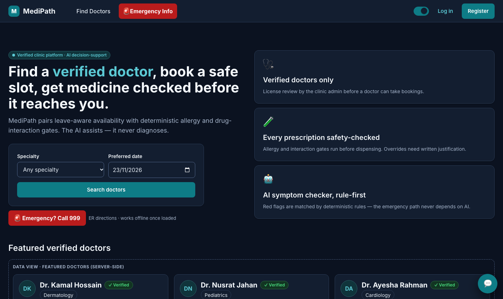
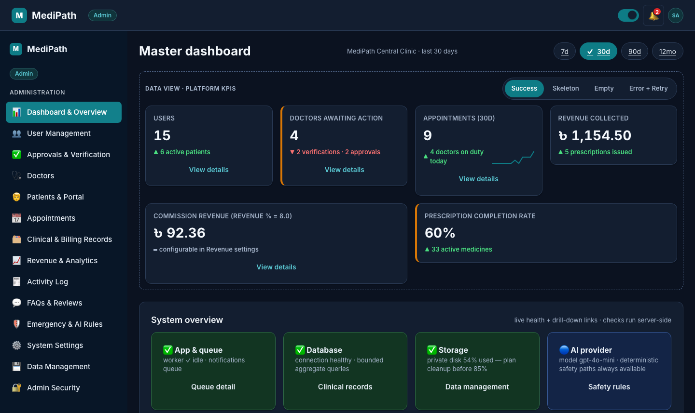
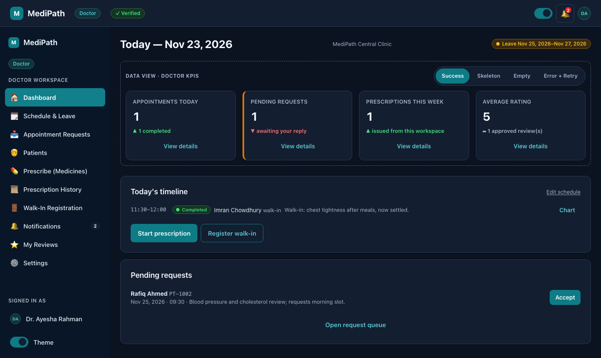
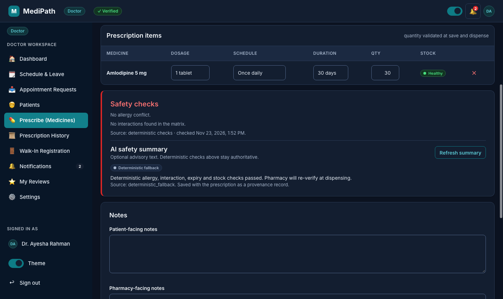
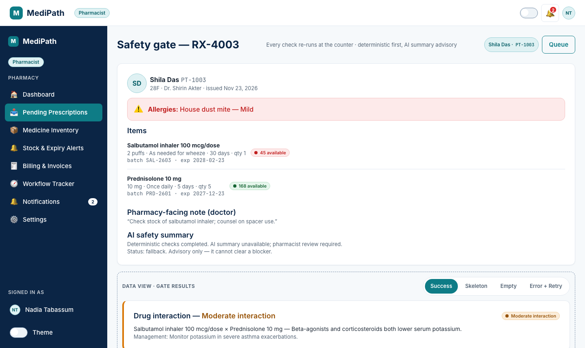
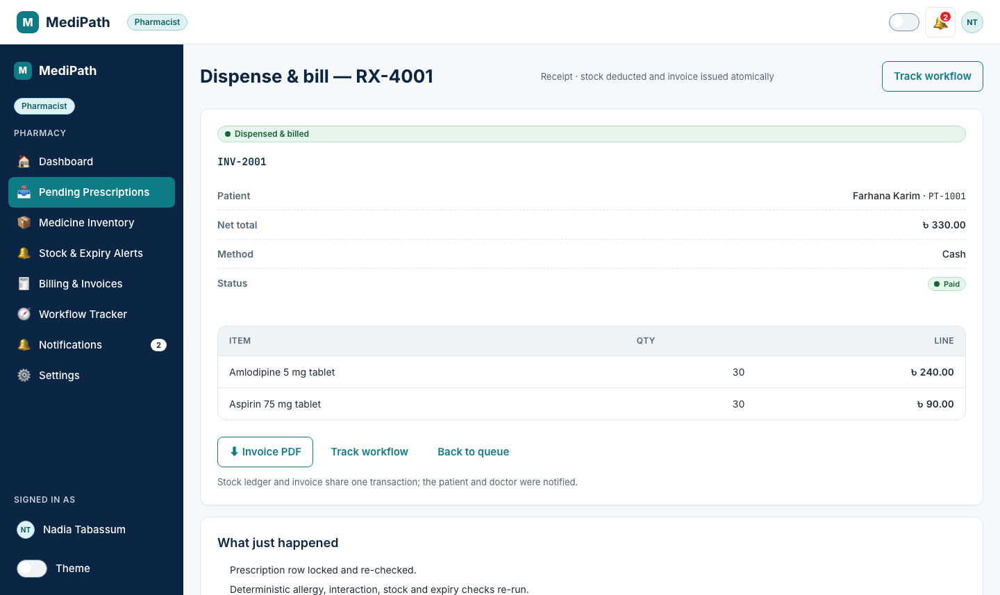
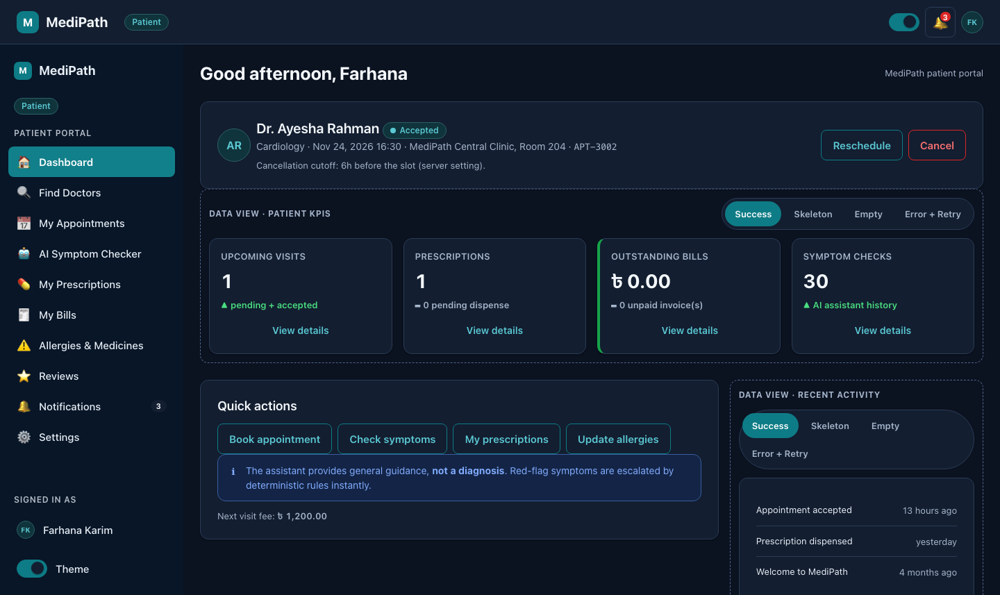
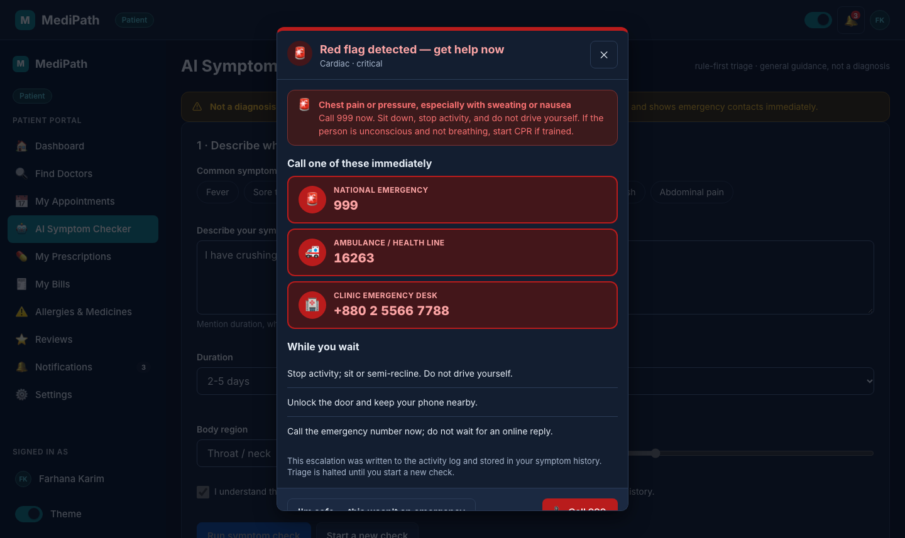

# MediPath

**AI-powered doctor appointment and medicine safety system** — a Laravel + React/Inertia clinic platform with four role portals: **admin, doctor, pharmacist, patient**.

MediPath was built as a CSE-479 lab project. It is published as an educational, open-source reference. It is **not a medical device** and must not be used with real patient data without a full clinical, legal and security review.

[](https://www.php.net/)
[](https://laravel.com/)
[](https://react.dev/)
[](https://www.mysql.com/)
[](LICENSE)

---

## Table of contents

- [What is included](#what-is-included)
- [Screens](#screens)
- [Tech stack](#tech-stack)
- [Repository layout](#repository-layout)
- [Requirements](#requirements)
- [Quick start with Docker](#quick-start-with-docker)
- [Manual setup](#manual-setup)
  - [macOS](#macos)
  - [Windows](#windows)
  - [Linux](#linux)
- [Environment variables](#environment-variables)
- [Database setup](#database-setup)
- [Run the app](#run-the-app)
- [Demo accounts](#demo-accounts)
- [Tests](#tests)
- [Graphify knowledge graph](#graphify-knowledge-graph)
- [Useful commands](#useful-commands)
- [Troubleshooting](#troubleshooting)
- [Contributing](#contributing)
- [Security](#security)
- [License](#license)

---

## What is included

| Role | Capabilities |
|---|---|
| **Guest** | Landing page, verified doctor directory and profiles, emergency guidance, registration, login, password reset, FAQ chatbot |
| **Patient** | Dashboard, appointment booking/reschedule/cancel, prescriptions, bills and PDFs, allergy/medication profile, reviews, notifications, settings, two-stage symptom checker with deterministic red-flag emergency escalation |
| **Doctor** | Dashboard, weekly schedule and leave, appointment requests, patient list/charts, walk-in registration, prescription builder with allergy/interaction/stock safety gate, optional AI safety summary, prescription history and PDFs, reviews, notifications, settings |
| **Pharmacist** | Dashboard, pending queue, pre-dispense safety gate, atomic dispense + billing, inventory/restock/archive, stock and expiry alerts, invoices and PDFs, six-stage workflow tracker, notifications, settings |
| **Admin** | Dashboard, users, approvals/verification, doctors, patients, appointments, clinical/billing records, reports, activity log, FAQ/reviews moderation, emergency and AI rules, settings, data management, security |

Cross-cutting behaviour:

- Four data states (`success`, `skeleton`, `empty`, `error`) on data-bound views.
- Light and dark themes with WCAG AA focus and contrast tokens.
- Server-authoritative safety checks; AI is optional and advisory.
- Append-only activity and inventory ledgers.
- Responsive layouts tested at 360 / 640 / 768 / 992 / 1024 / 1440 px.
- Pest feature suite + Laravel Dusk browser suite + GitHub Actions CI.

> **AI note:** the app runs deterministically without any provider key. An optional OpenAI-backed safety summary can be enabled with `OPENAI_API_KEY` plus the `ai_enabled`/`ai_model` settings; the deterministic checks always remain authoritative.

---

## Screens

Curated screenshots live in [`Docs/screenshots/`](Docs/screenshots/). Open the full interactive graph at [`graphify-out/graph.html`](graphify-out/graph.html).

| Landing | Admin dashboard |
|---|---|
|  |  |

| Doctor dashboard | Doctor AI-assisted prescribing |
|---|---|
|  |  |

| Pharmacist safety gate | Dispense receipt |
|---|---|
|  |  |

| Patient dashboard | Emergency triage |
|---|---|
|  |  |

---

## Tech stack

| Layer | Choice |
|---|---|
| Backend | PHP 8.4, Laravel 12 |
| Frontend | React 18, TypeScript, Inertia 2, Vite 7 |
| UI | Bootstrap 5.3 bridge + custom SCSS design system |
| Database | MySQL 8.x (FULLTEXT + CHECK constraints; 8.4 tested) |
| Cache/queue | Database by default; Redis supported |
| Realtime | Laravel Reverb + Echo (optional) |
| PDFs | barryvdh/laravel-dompdf |
| Tests | Pest 3, Laravel Dusk |
| CI | GitHub Actions (Pest + TypeScript + production build) |

---

## Repository layout

```text
.
├── README.md
├── LICENSE
├── CONTRIBUTING.md
├── SECURITY.md
├── CODE_OF_CONDUCT.md
├── compose.yaml                 ← MySQL + Redis for local development
├── .github/workflows/ci.yml
├── Docs/
│   └── screenshots/            ← curated public screenshots
├── design-out/                 ← prototypes and design contracts
├── graphify-out/               ← generated knowledge graph + report
└── medipath/                   ← Laravel application
    ├── app/
    ├── database/
    ├── resources/js/
    ├── routes/web.php
    ├── tests/
    └── Docs/                   ← detailed phase documentation
```

The Laravel app lives in `medipath/`. All commands below assume you are inside that directory unless stated otherwise.

---

## Requirements

| Tool | Version |
|---|---|
| PHP | **8.4** (8.2+ may work, 8.4 is tested) |
| Composer | 2.x |
| Node.js | **22 LTS** recommended (Vite 7 needs Node 20.19+ or 22.12+) |
| npm | 10+ |
| MySQL | **8.0+** (8.4 is tested and used by `compose.yaml`) |
| Redis | Optional (default config uses the database) |
| Docker | Optional, for MySQL + Redis only |
| Chrome | Optional, only for Dusk browser tests |

Required PHP extensions:

```text
bcmath, ctype, curl, dom, fileinfo, gd, intl, mbstring,
openssl, pdo_mysql, tokenizer, xml, zip
```

`intl` is required by the currency formatter (`NumberFormatter`).

---

## Quick start with Docker

This is the least painful path. Docker only runs **MySQL and Redis**; PHP/Node still run on your machine.

### 1. Clone

```bash
git clone https://github.com/<your-user>/medipath.git medipath-repo
cd medipath-repo
```

### 2. Start MySQL + Redis

```bash
docker compose up -d
docker compose ps
```

The first start creates:

| Service | Host | Port | Database/user |
|---|---|---|---|
| MySQL | `127.0.0.1` | `3306` | `medipath` / `medipath` / `medipath` |
| MySQL root | `127.0.0.1` | `3306` | `root` / `root` |
| Redis | `127.0.0.1` | `6379` | no password |

It also creates `medipath_test` and `medipath_dusk` for the test suites.

If port `3306` or `6379` is already taken:

```bash
MYSQL_PORT=3307 REDIS_PORT=6380 docker compose up -d
```

Then update `DB_PORT` / `REDIS_PORT` in `.env`.

### 3. Configure the app

**macOS / Linux**

```bash
cd medipath
cp .env.example .env
php artisan key:generate
```

**Windows PowerShell**

```powershell
cd medipath
Copy-Item .env.example .env
php artisan key:generate
```

**Windows CMD**

```bat
cd medipath
copy .env.example .env
php artisan key:generate
```

### 4. Install, migrate and run

```bash
composer install
npm ci
php artisan migrate:fresh --seed
php artisan storage:link
```

Start the app:

```bash
php artisan serve
```

In a second terminal:

```bash
npm run dev
```

Open <http://127.0.0.1:8000>.

For a production-style asset build instead of Vite dev mode:

```bash
npm run build
php artisan serve
```

---

## Manual setup

Use this if you prefer native MySQL/Redis instead of Docker. The section order is: install tools → create databases → configure `.env`.

### macOS

Install Homebrew if needed, then:

```bash
brew install php@8.4 composer mysql redis node@22   # MySQL 8.x; use mysql@8.4 for exact parity if available

# PHP 8.4 and Node 22 may be keg-only; add them to PATH:
echo 'export PATH="/opt/homebrew/opt/php@8.4/bin:$PATH"' >> ~/.zshrc
echo 'export PATH="/opt/homebrew/opt/node@22/bin:$PATH"' >> ~/.zshrc
source ~/.zshrc

brew services start mysql
brew services start redis   # optional
```

Verify:

```bash
php -v
composer -V
node -v
mysql --version
```

Create the databases (see [Database setup](#database-setup)), then continue with [Configure the app](#3-configure-the-app).

> If Homebrew’s MySQL root account has no password, keep `DB_USERNAME=medipath` / `DB_PASSWORD=medipath` after creating that user, or change `.env` to `root` with an empty password.

### Windows

**Recommended: [Laragon Full](https://laragon.org/download/)**. It bundles PHP, MySQL, Composer, Node and a terminal. Select PHP 8.4 and MySQL 8 in Laragon. WSL2 with the Ubuntu steps below is also supported.

Alternative with `winget` (admin PowerShell):

```powershell
winget install PHP.PHP.8.4
winget install Composer.Composer
winget install OpenJS.NodeJS.LTS
winget install Oracle.MySQL
```

Then:

1. Add PHP and Composer to `PATH` if the installers did not.
2. Enable these extensions in `php.ini` (remove the leading `;`):
   `pdo_mysql`, `mbstring`, `openssl`, `fileinfo`, `gd`, `zip`, `intl`, `curl`, `bcmath`.
3. Start MySQL from Laragon or Windows Services.
4. Redis is **not required** with the default `.env` (database cache/session/queue). If you want it, use Docker Desktop or Memurai.
5. Create the databases using Laragon’s terminal or MySQL Workbench (see below).
6. Continue with [Configure the app](#3-configure-the-app).

> `php artisan storage:link` may need an elevated terminal on Windows. If it fails, create a junction manually:
> ```bat
> mklink /J public\storage storage\app\public
> ```

### Linux

**Ubuntu / Debian**

```bash
sudo add-apt-repository ppa:ondrej/php
sudo apt update
sudo apt install -y \
  php8.4-cli php8.4-bcmath php8.4-curl php8.4-gd php8.4-intl \
  php8.4-mbstring php8.4-mysql php8.4-xml php8.4-zip \
  unzip git mysql-server redis-server

# Composer
curl -sS https://getcomposer.org/installer | php
sudo mv composer.phar /usr/local/bin/composer

# Node 22 via nvm (recommended)
curl -o- https://raw.githubusercontent.com/nvm-sh/nvm/v0.40.1/install.sh | bash
source ~/.bashrc
nvm install 22
nvm use 22
```

**Fedora / RHEL**

```bash
sudo dnf install -y php-cli php-mysqlnd php-mbstring php-xml php-gd \
  php-zip php-bcmath php-intl composer nodejs npm mysql-server redis
sudo systemctl enable --now mysqld
sudo systemctl enable --now redis   # optional
```

Verify `php -v`, `composer -V`, `node -v`, then create the databases and continue.

---

## Environment variables

Copy `.env.example` to `.env`. The important local values are:

```dotenv
APP_URL=http://127.0.0.1:8000

DB_CONNECTION=mysql
DB_HOST=127.0.0.1
DB_PORT=3306
DB_DATABASE=medipath
DB_USERNAME=medipath
DB_PASSWORD=medipath

SESSION_DRIVER=database
CACHE_STORE=database
QUEUE_CONNECTION=database
BROADCAST_CONNECTION=log

REDIS_HOST=127.0.0.1
REDIS_PORT=6379

MEDIPATH_DEFAULT_CURRENCY=BDT
MEDIPATH_ADMIN_EMAIL=admin@medipath.test
MEDIPATH_DEMO_PASSWORD=MediPath#2026
```

Useful switches:

- **Redis sessions/cache/queue:** set `SESSION_DRIVER=redis`, `CACHE_STORE=redis`, `QUEUE_CONNECTION=redis`.
- **Live notifications:** set `BROADCAST_CONNECTION=reverb` and run `php artisan reverb:start`; keep `log` for the simplest local setup.
- **AI safety summary:** add `OPENAI_API_KEY`, then set `ai_enabled` and `ai_model` in Admin → System Settings. Without it, the labelled deterministic fallback is used.

Never commit `.env`. It is already ignored.

---

## Database setup

### With Docker

Nothing to do — `compose.yaml` creates the databases on first start.

Verify:

```bash
docker compose exec mysql mysql -umedipath -pmedipath -e "SHOW DATABASES;"
```

### With native MySQL

Run as a MySQL administrator:

```sql
CREATE DATABASE IF NOT EXISTS medipath
  CHARACTER SET utf8mb4 COLLATE utf8mb4_unicode_ci;
CREATE DATABASE IF NOT EXISTS medipath_test
  CHARACTER SET utf8mb4 COLLATE utf8mb4_unicode_ci;
CREATE DATABASE IF NOT EXISTS medipath_dusk
  CHARACTER SET utf8mb4 COLLATE utf8mb4_unicode_ci;

CREATE USER IF NOT EXISTS 'medipath'@'%' IDENTIFIED BY 'medipath';
GRANT ALL PRIVILEGES ON medipath.* TO 'medipath'@'%';
GRANT ALL PRIVILEGES ON medipath_test.* TO 'medipath'@'%';
GRANT ALL PRIVILEGES ON medipath_dusk.* TO 'medipath'@'%';
FLUSH PRIVILEGES;
```

Then from the app directory:

```bash
php artisan migrate:fresh --seed
```

`migrate:fresh` is destructive. For a first run it is safe; on an existing database it drops all tables.

The seed creates the demo clinic, doctors, patients, medicines, prescriptions, invoices and reviews.

---

## Run the app

### Terminal setup A — separate processes (recommended on Windows)

```bash
php artisan serve
```

```bash
npm run dev
```

Optional queue worker (only needed if `QUEUE_CONNECTION` is not `sync`):

```bash
php artisan queue:work
```

Optional Reverb websocket server:

```bash
php artisan reverb:start
```

### Terminal setup B — one command (macOS/Linux)

```bash
composer run dev
```

This runs the PHP server, queue listener, log viewer and Vite together.

Open <http://127.0.0.1:8000>.

---

## Demo accounts

All seeded accounts use:

```text
Password: MediPath#2026
```

| Role | Email |
|---|---|
| Admin | `admin@medipath.test` |
| Doctor | `ayesha.rahman@medipath.test` |
| Pharmacist | `pharmacist@medipath.test` |
| Patient | `patient@medipath.test` |

Additional doctors and patients are seeded for directory, appointment and review flows. **These credentials are for local demo only.** Change or remove them before exposing an instance publicly.

---

## Tests

### Pest feature suite

```bash
php artisan test --compact
```

The suite uses `medipath_test` and the credentials in `phpunit.xml`. With Docker the database is created automatically. Native MySQL users should run the SQL in [Database setup](#database-setup).

### TypeScript and production build

```bash
npm run typecheck
npm run build
```

### Dusk browser tests (optional)

Dusk requires Google Chrome and a ChromeDriver.

```bash
# macOS / Linux
php artisan dusk:chrome-driver --detect

# Windows PowerShell
php artisan dusk:chrome-driver --detect
```

Create `.env.dusk.local` from `.env.dusk.example`, copy your `APP_KEY` from `.env`, then seed the Dusk database:

```bash
php artisan migrate:fresh --seed --env=dusk.local
php artisan dusk
```

Dusk tests mutate the Dusk database. They are not run in CI because they need a visible browser stack.

---

## Graphify knowledge graph

The repository includes the generated graph so forks can explore the architecture immediately:

```text
graphify-out/graph.html       interactive graph — open directly in a browser
graphify-out/graph.json       machine-readable graph
graphify-out/GRAPH_REPORT.md  communities, god nodes, audit report
graphify-out/manifest.json    incremental build manifest
graphify-out/cost.json        token/cost history
```

Machine-specific files (`.graphify_python`, `.graphify_root`) and the extraction cache are intentionally **not** committed.

To rebuild the graph after changing the code:

```bash
# One-time install
python -m pip install graphifyy
# or: uv tool install graphifyy

graphify update .
```

Graphify is optional; the application does not depend on it at runtime. Pin the version if you publish updated graph outputs.

---

## Useful commands

| Task | Command |
|---|---|
| Clear caches | `php artisan optimize:clear` |
| Re-run migrations + demo data | `php artisan migrate:fresh --seed` |
| List routes | `php artisan route:list` |
| Run queue worker | `php artisan queue:work` |
| Start Reverb | `php artisan reverb:start` |
| Build assets | `npm run build` |
| TypeScript check | `npm run typecheck` |
| Format PHP | `vendor/bin/pint` |
| Stop Docker services | `docker compose down` |
| Delete Docker data | `docker compose down -v` |

---

## Troubleshooting

### `could not find driver`

Enable `pdo_mysql` in `php.ini`, then restart PHP.

### `SQLSTATE[HY000] [2002] Connection refused`

MySQL is not running, or the host/port is wrong. Check:

```bash
docker compose ps
# or
mysqladmin ping -h 127.0.0.1 -u medipath -p
```

If port 3306 is occupied, change `MYSQL_PORT` and `DB_PORT`.

### `Access denied for user 'medipath'`

Create the user and grants from [Database setup](#database-setup), or use your own MySQL credentials in `.env`.

### `Vite manifest not found`

Run `npm run build` once, or keep `npm run dev` running while developing.

### `No application encryption key has been specified`

Run:

```bash
php artisan key:generate
```

### `Class "NumberFormatter" not found` or currency formatting fails

Install/enable the PHP `intl` extension.

### `storage:link` fails on Windows

Open an elevated terminal, or create a junction:

```bat
mklink /J public\storage storage\app\public
```

### Redis connection refused

The default `.env.example` uses database sessions/cache/queue, so Redis is optional. Either start Redis or keep `SESSION_DRIVER=database`, `CACHE_STORE=database`, `QUEUE_CONNECTION=database`.

### Dusk cannot find Chrome

Install Google Chrome, run `php artisan dusk:chrome-driver --detect`, and make sure no other ChromeDriver is bound to port 9515.

### Tests fail with an unknown database

Create `medipath_test` and grant the `medipath` user access, or update `phpunit.xml` to your MySQL credentials.

---

## Contributing

See [`CONTRIBUTING.md`](CONTRIBUTING.md). In short:

1. Fork the repository.
2. Create a branch: `git checkout -b feature/my-change`.
3. Make the change and add tests.
4. Run `php artisan test --compact`, `npm run typecheck`, and `npm run build`.
5. Open a pull request with a clear description.

Please do not commit secrets, real patient data or generated `vendor/`/`node_modules/` folders.

---

## Security

See [`SECURITY.md`](SECURITY.md). Report vulnerabilities privately rather than opening a public issue.

**Never** commit:

- `.env` files or API keys
- real patient information or credentials
- `storage/app/private` contents
- database dumps
- `graphify-out/.graphify_python` or `.graphify_root`

The seeded demo data is fictional.

---

## License

MIT — see [`LICENSE`](LICENSE).

You are free to fork, modify and use the code with attribution. MediPath is an educational project; clinical use requires independent medical, legal and security review.